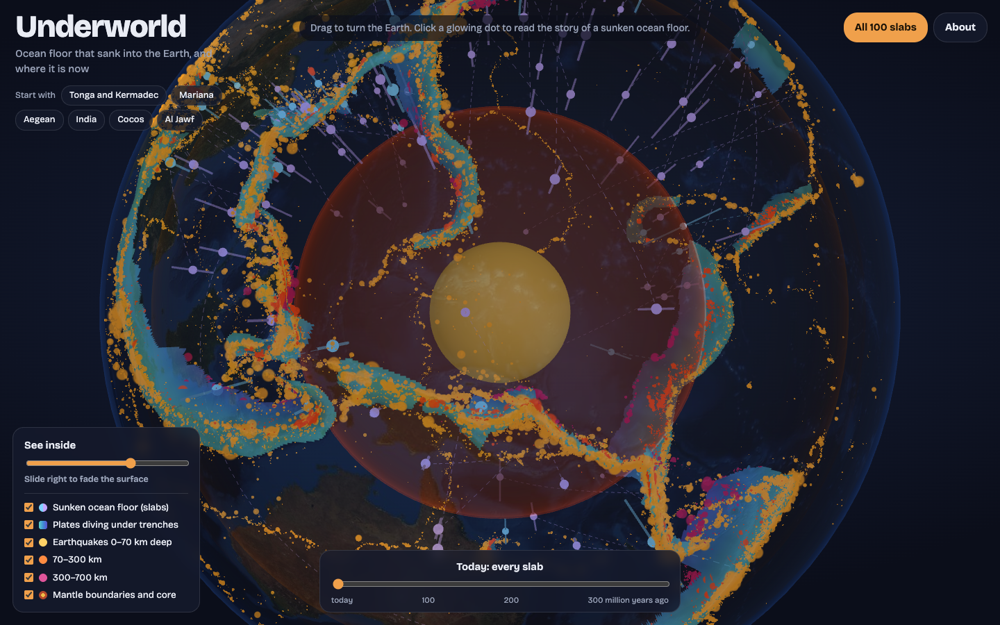
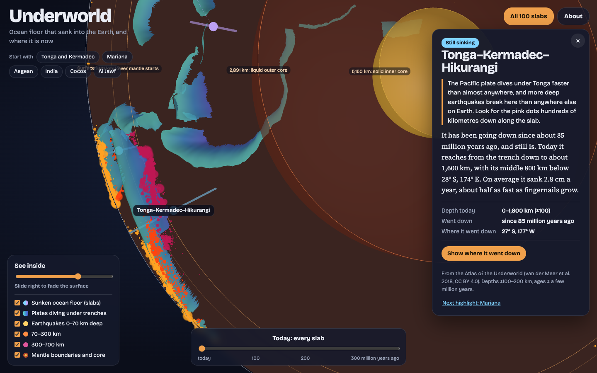
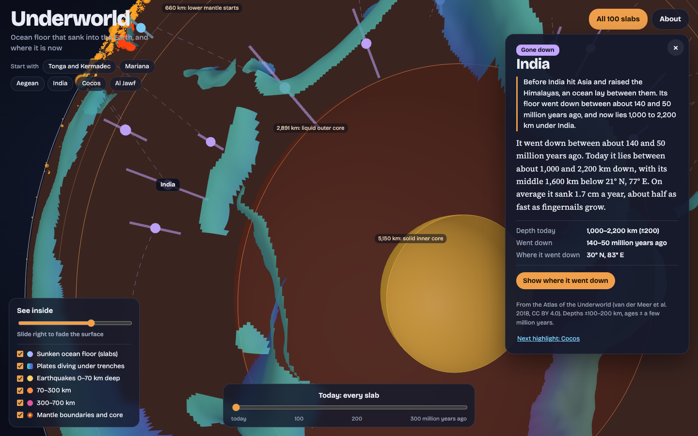
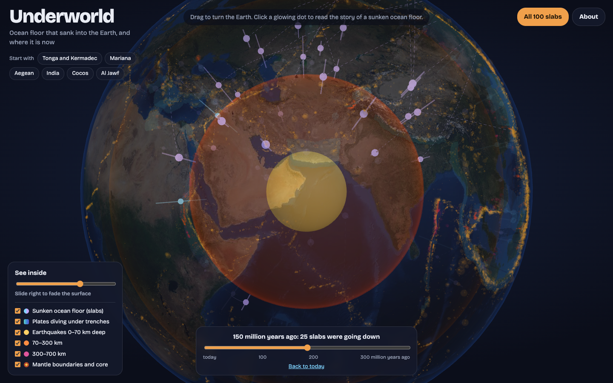
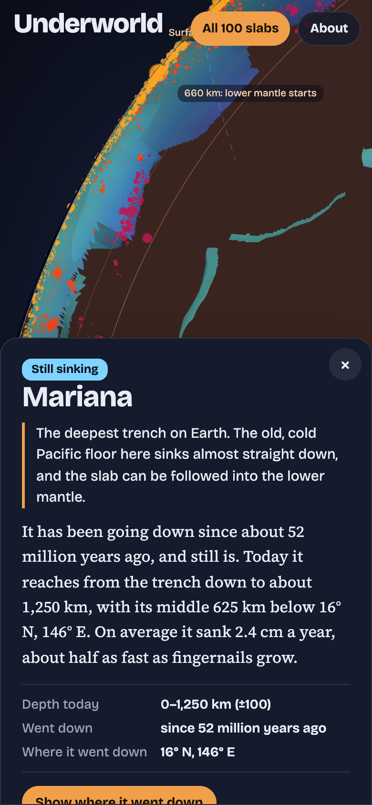

# Underworld

**The ocean floors that sank into the Earth, and where they are now.** An open 3D globe of the mantle.

When plates meet, old ocean floor bends down into the mantle at a trench and keeps sinking, a centimetre or two a year,
for a hundred million years or more. Seismologists find these cold slabs because earthquake waves cross them a little
faster. Underworld puts them on a globe at their true depth, together with the plates diving under trenches today and
the earthquakes that break inside them, and tells each slab's story in plain words.

- **100 sunken slabs** from the Atlas of the Underworld, each at its real depth: blue if it is still going down, lilac
  if it went down long ago. A bar spans its top and base; a dashed line joins it to the place where the rocks at the
  surface record its subduction.
- **Click a slab and the Earth is cut open** along its meridian: the mantle, the 660 km boundary and the core appear as
  a cross-section, with the slab and the earthquakes around it in a 760 km slice.
- **The plates diving under trenches today** (USGS Slab2, 27 subduction zones) as 3D surfaces coloured by depth.
- **89,682 earthquakes** of magnitude 5 and above since 1973 (USGS), coloured by depth: shallow, intermediate, deep.
- **A time slider** shows which slabs were going down at a chosen age, up to 300 million years ago.
- **See inside** fades the surface; six highlights (Tonga, Mariana, Aegean, India, Cocos, Al Jawf) are a place to start.



| Tonga and Kermadec, cut open | India: ocean floor that closed before the Himalayas |
|---|---|
|  |  |

| 150 million years ago | On a phone |
|---|---|
|  |  |

Every slab has a link, for example `#slab=TKH` (Tonga–Kermadec–Hikurangi) or `#slab=In` (India).

## Why

The slabs are known, but the tools that show them are built for specialists: the Seismic Tomography Globe and SubMachine
show raw velocity anomalies without a plain-language legend, and the Atlas of the Underworld itself is a 2D map. None
puts the named slabs, today's subduction zones and the earthquakes in one cut-open view with a story for each slab.

## Data

| Layer | Source | Licence |
|---|---|---|
| Sunken slabs: names, depth range, middle point, ages, sinking rates, surface record | van der Meer, van Hinsbergen and Spakman (2018) *Atlas of the underworld*, Tectonophysics 723, [doi:10.1016/j.tecto.2017.10.004](https://doi.org/10.1016/j.tecto.2017.10.004); table as updated in 2019 on [atlas-of-the-underworld.org](https://www.atlas-of-the-underworld.org) | CC BY 4.0 (article) |
| Plates under trenches | Hayes (2018) Slab2, U.S. Geological Survey, [doi:10.5066/F7PV6JNV](https://doi.org/10.5066/F7PV6JNV) | public domain / CC0 |
| Earthquakes, M5+, 1973 onwards | USGS ComCat, [FDSN event service](https://earthquake.usgs.gov/fdsnws/event/1/) | public domain |
| Surface image | NASA Blue Marble through [GIBS](https://earthdata.nasa.gov/gibs) | public domain |

Seismic tomography images are **not** included: none of the models checked (UU-P07, S40RTS and others on EarthScope's
Earth Model Collaboration) states reuse terms beyond a request to cite.

Stored files (`public/data/`, 3.1 MB):

- `slabs.json` (18 KB) from `npm run data:atlas`. Three Telkhinia slabs give ages as geological periods; they are
  converted with the ICS 2023 chart (Triassic 251.9–201.4 Ma, Early Cretaceous 145.0–100.5 Ma) and flagged on the
  page. A sinking rate of 9999 in the source means "not estimated".
- `quakes.bin` (877 KB, 10 bytes per event) from `npm run data:quakes`, fetched in 5-year windows below the API limit.
- `plates/` (2.2 MB, 27 zones, 107,242 triangles) from `npm run data:slab2`: Slab2 depth grids thinned to 0.2°.
  ScienceBase answers scripts with a bot check, so the 27 depth grids were collected in a normal browser session into
  `data-raw/slab2_bundle.json` (not committed) and converted by `scripts/build_slab2.py`.

## Honest limits

- Slab positions, depths and ages come from reading tomography and plate history: about ±100–200 km in depth and a few
  million years in age. A slab's dot marks its middle; the real slab is a sheet hundreds of kilometres wide.
- The dashed path from the surface record to the slab is a guide for the eye, not the route the slab took (plates have
  moved since it went down).
- Slab2 covers the upper part of today's slabs (down to about 700 km) and only active subduction zones.

## Development

```sh
npm install
npx vite --port 5299   # http://localhost:5299/
npm test               # coordinates, slab stories, data file checks
npm run build          # typecheck + production build
npm run shots          # regenerate docs/img/*.png and the social image (needs Google Chrome)
```

Pushes to `main` run the tests and the build and deploy to Cloudflare Pages when the repository secret
`CLOUDFLARE_API_TOKEN` is set.

Code: MIT. Part of [Bristlecone Lab](https://bristleconelab.org); see also
[Ocean Life Atlas](https://oceanlife.bristleconelab.org) and [Global Seismicity Atlas](https://seismicityatlas.org).
