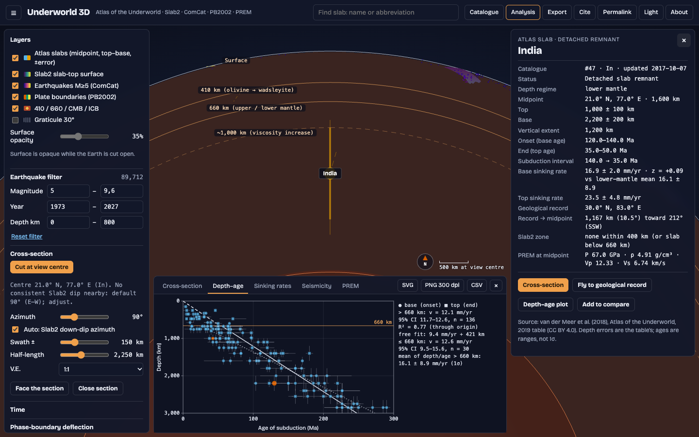
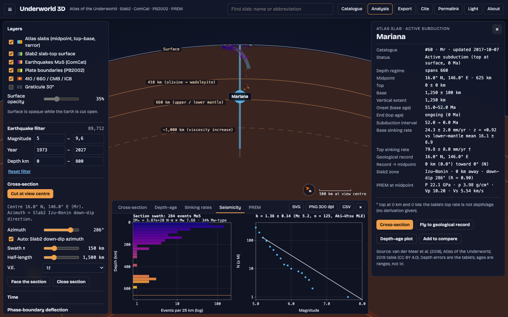
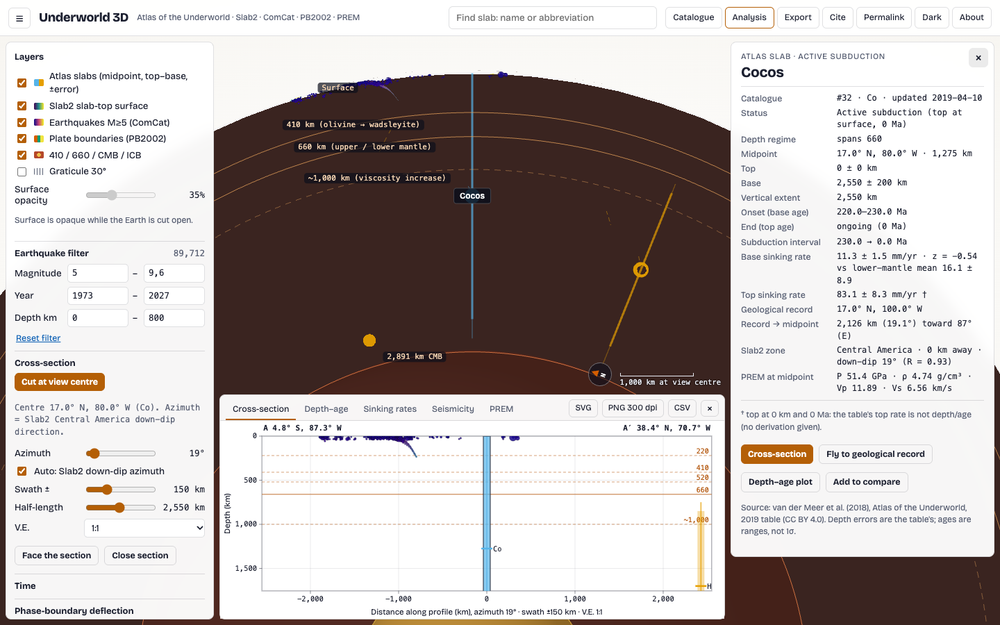

# Underworld 3D

**A 3D workbench for subduction and the mantle.** The 100 slab remnants of the Atlas of the Underworld with their depth
and age uncertainties, today's slab-top geometry, thickness and depth uncertainty from USGS Slab2, 89,712 M≥5 earthquakes from ComCat, PB2002 plate
boundaries and the PREM reference Earth, on one globe at true depth, with great-circle cross-sections, regression and
magnitude statistics, and export of every table and figure.

Live: **https://underworld.bristleconelab.org**


## What it does

- **Great-circle cross-sections.** Select a slab and the Earth is cut along a vertical plane through its midpoint. For
  slabs that reach the upper mantle near a Slab2 zone (42 of 100), the profile azimuth defaults to the mean Slab2
  down-dip direction, so Tonga, Mariana, the Andes or Japan are cut across strike and the Wadati–Benioff zone shows
  its true dip. Azimuth (0–359°), swath half-width (25–500 km, default ±150 km), half-length and vertical exaggeration
  (1:1, 2:1, 5:1) are adjustable; “Cut at view centre” makes a section anywhere.
- **Synchronised 2D profile** (SVG): distance along the profile × depth, with earthquakes sized by magnitude, projected
  Slab2 nodes, Atlas slabs with top/base error bars, PB2002 boundary crossings with relative velocity, and the 220,
  410, 520, 660, ~1,000 km and CMB reference depths. Slab2 is drawn as its slab top with the ±1σ depth uncertainty
  and the slab body down to the vertical thickness thk / cos(dip). Click an event or a slab to inspect it.
- **Depth–age analysis.** Base (onset) and top (end) of every slab with age ranges and depth errors, OLS fits through
  the origin above and below 660 km with 95% confidence intervals, and a free-intercept lower-mantle fit. The catalogue
  gives **12.1 mm/yr (95% CI 11.7–12.6, n = 136, R² 0.77)** below 660 km, the ~12 mm/yr of van der Meer et al. (2018).
- **Sinking rates** versus depth, base and top, with their errors (log scale).
- **Seismicity**: depth histogram of the current section swath (or the filtered global catalogue), cumulative
  Gutenberg–Richter plot, maximum-likelihood b-value with σ and Mc, summed seismic moment and equivalent Mw, and the
  share of Mw-type magnitudes (mb/Ms saturate, so their moments are lower bounds). In a section, events are also
  classed against Slab2: at the slab top within ±1σ, inside the slab (down to its thickness), above or beneath it
  (Tonga, ±150 km swath: 71% at the slab top, 20% inside the slab).
- **PREM** profile (Vp, Vs, ρ, pressure, gravity) with the selected slab's depth marked, a cursor HUD that gives
  latitude, longitude, depth, P, Vp, Vs and ρ under the pointer, and a phase-boundary deflection calculator
  (Δz = γΔT/ρg, Clapeyron slopes with literature ranges).
- **Inspectors** for slabs (all catalogue fields, rate z-score, surface-record offset by great-circle distance and
  azimuth, linked Slab2 zone), earthquakes (UTC time, location and depth errors, magnitude type, M₀, signed distance from
  the Slab2 slab top and position relative to the slab, USGS event page) and Slab2 points (depth ± σ, thickness, dip,
  strike). Slab2 can be coloured by depth, thickness or depth uncertainty.
- **Catalogue table**: search, sort on every column, filter by status and depth regime, compare up to three slabs.
- **Earthquake filters** by magnitude, year and depth, applied on the GPU.
- **Time**: either a subduction-activity filter at present-day positions, or kinematic back-advection
  z(t) = max(0, z − v·t) under the Atlas's vertical-sinking assumption. Neither reconstructs plate motion; the page says so.
- **Export**: catalogue CSV/GeoJSON, filtered events CSV, section projection CSV, any chart as SVG or 300 dpi PNG, the
  3D view as PNG, the view state as JSON; BibTeX/RIS/APA references; a permalink that restores slab, section, filters,
  time, layers, theme, open chart and camera.
- Dark (screen) and light (print) themes; colour maps viridis and plasma, categorical colours Okabe–Ito.

| Tonga–Kermadec, cut along the 281° down-dip azimuth | Depth–age with the lower-mantle fit |
|---|---|
|  |  |

| Mariana: depth histogram and Gutenberg–Richter | Back-advection to 150 Ma |
|---|---|
|  |  |

| Light theme, Cocos section | Phone |
|---|---|
|  |  |

Deep links, for example `#slab=TKH&tab=section`, `#slab=In&tab=depthage`,
`#sec=142,38,290,1500,100&mag=6,9.6&tab=seismicity`.

## Data

| Layer | Source | Licence |
|---|---|---|
| Slab remnants: midpoint, top/base depth ± error, onset/end age ranges, sinking rates ± σ, geological record | van der Meer, van Hinsbergen & Spakman (2018) *Atlas of the underworld*, Tectonophysics 723, [doi:10.1016/j.tecto.2017.10.004](https://doi.org/10.1016/j.tecto.2017.10.004); 2019 table from [atlas-of-the-underworld.org](https://www.atlas-of-the-underworld.org) | CC BY 4.0 (article) |
| Slab-top depth, thickness, depth uncertainty, dip, strike (27 zones) | Hayes (2018) Slab2, USGS, [doi:10.5066/F7PV6JNV](https://doi.org/10.5066/F7PV6JNV) | public domain |
| Earthquakes M≥5 since 1973 | USGS ComCat, [FDSN event service](https://earthquake.usgs.gov/fdsnws/event/1/), [doi:10.5066/F7MS3QZH](https://doi.org/10.5066/F7MS3QZH) | public domain |
| Plate boundaries, step classes, relative velocities | Bird (2003) PB2002, [doi:10.1029/2001GC000252](https://doi.org/10.1029/2001GC000252); GeoJSON by H. Ahlenius, [fraxen/tectonicplates](https://github.com/fraxen/tectonicplates) | ODC-BY 1.0 |
| Reference Earth | Dziewonski & Anderson (1981) PREM, [doi:10.1016/0031-9201(81)90046-7](https://doi.org/10.1016/0031-9201(81)90046-7) | published model |
| Surface image | NASA Blue Marble via [GIBS](https://earthdata.nasa.gov/gibs) | public domain |

**Not included.** Seismic tomography, Global CMT focal mechanisms, LLSVP outlines and palaeogeographic reconstructions:
none of the candidate sources states reuse terms beyond a request to cite, or they need a plate model this site does not
carry. Smithsonian GVP volcanoes: its terms allow non-commercial use only and need permission for publication.

### Stored files (`public/data/`, 5.5 MB) and how they are built

Each output records the SHA-256 of the raw input it was built from (`sourceSha256` / `responseSha256`).

- `slabs.json` (28 KB) — `npm run data:atlas`. In every row the first age column of each pair holds the older value
  whatever the header says (India: base 140/120, top 50/35); all ranges are stored as **[young, old] Ma**. `9999`
  (“not estimated”) becomes null in every column (Maldives has no surface record, ages or rates). Three Telkhinia slabs
  give ages as periods, converted with the ICS 2023/09 chart (Triassic 251.9–201.4 Ma, Early Cretaceous 145.0–100.5 Ma).
  Rate errors, catalogue number and update date are kept; a table rate of 0 with no age is a blank and becomes null.
  The build checks base rate = base depth ÷ mean age and lists the two slabs where the table disagrees by > 5%
  (Agattu, Mayn) in `rateCheck`; the page shows them as tabulated, with a note.
- `quakes.bin` (1.4 MB, 16 bytes/event: lon, lat, depth, magnitude, magnitude type, origin time, depth and horizontal
  error), `quakes_ids.txt` (USGS event ids, loaded only when an event is inspected), `quakes.json` —
  `npm run data:quakes`. 27 events located above sea level are set to 0 km and counted.
- `plates/` (3.1 MB, 27 zones, 109,418 triangles) — `npm run data:slab2`. Depth, thickness (km, perpendicular to the
  slab) and depth-uncertainty (km, 1σ) grids, which share the same nodes, thinned to 0.2°; cells with three of four
  corners inside the slab keep one triangle, so edges follow the outline. Dip and down-dip azimuth (strike + 90°) per
  node from Slab2's dip and str grids. The build recomputes both from the depth grid as a check and stops if they
  disagree: over 1,020,954 full-resolution nodes the mean |dip difference| is 0.04° (99% within 0.93°) and 95% of
  azimuths agree within 0.96° (`gradientCheck` per zone; largest in Sumatra–Java, mean 0.33°). Pamir, Himalaya, Halmahera and Hindu Kush carry Slab2's default thickness of 100 km everywhere
  (`thkDefault` in `index.json`; the page says so). `index.json` links Atlas slabs above 660 km to the nearest zone
  within 400 km with the mean down-dip azimuth and its circular consistency R. ScienceBase answers scripts with a bot
  check, so the grids were fetched inside a normal browser session into `data-raw/slab2_bundle.json` (depth) and
  `data-raw/slab2_thk_unc_bundle.json` (thickness, uncertainty) and `data-raw/slab2_dip_str_bundle.json` (dip,
  strike), each file with the SHA-256 computed in the browser and re-checked by the build; not committed.
- `pb2002.bin` (113 KB, 5,824 steps) — `npm run data:boundaries`.

## Method notes and limits

- Sphere of radius 6,371 km; latitudes are treated as geocentric although the sources give WGS84 geodetic latitudes
  (≤ 0.19°, about 21 km), below the Atlas uncertainties of 50–200 km.
- Section distances are arc lengths at the surface; data within the swath are projected orthogonally onto the plane.
- Atlas positions are a slab's midpoint; the real slab is a sheet hundreds of kilometres wide. Depth errors are the
  table's; age ranges are ranges, not 1σ.
- The dashed line from a slab's geological record to its midpoint is the great-circle path (SLERP), not the route the
  slab took.
- b-values use M ≥ Mc only (Mc by maximum curvature + 0.2, never below 5.0); sections with fewer than 50 such events
  report none.
- Earthquake symbol area is proportional to M₀^(1/3), i.e. to rupture radius at constant stress drop, clamped to
  1.5–22 px.

## Architecture

```
src/
  core/      store.ts (typed state, URL permalink), format.ts, colormap.ts
  science/   geodesy.ts (sphere, haversine, bearing, SLERP), prem.ts, seismology.ts (M0, b-value),
             stats.ts (OLS + CI), section.ts (great-circle projection), slabs.ts (intervals, back-advection, fits)
  data/      decode.ts (binary formats), schema.ts (runtime validators), spatial.ts (hash grid, distance to Slab2),
             load.ts, export.ts (CSV, GeoJSON, SVG/PNG, BibTeX/RIS/APA)
  render3d/  globe.ts (on-demand rendering, instanced slabs, one merged Slab2 mesh, GPU-filtered quakes,
             arbitrary section clipping, context-loss handling)
  charts2d/  svg.ts (scales, axes), charts.ts (section, depth-age, rates, seismicity, PREM)
  ui/        inspector.ts, table.ts, analysis.ts, dom.ts
```

The globe draws 14–17 calls per frame and renders only when something changes (0 frames while idle).

## Development

```sh
npm install
npx vite --port 5299   # http://localhost:5299/
npm test               # 30 tests: data files and validators, PREM against published values, geodesy, sections,
                       # b-value on a synthetic sample, regression, URL state, CSV parsing
npm run test:py        # build_atlas.py conventions (9999, age order, periods)
npm run build          # typecheck + production build
npm run shots          # regenerate docs/img/*.png and the social image (needs Google Chrome)
```

Pushes to `main` run both test suites and the build, then deploy to Cloudflare Pages.

Code: MIT. Part of [Bristlecone Lab](https://bristleconelab.org); see also
[Ocean Life Atlas](https://oceanlife.bristleconelab.org) and [Global Seismicity Atlas](https://seismicityatlas.org).
